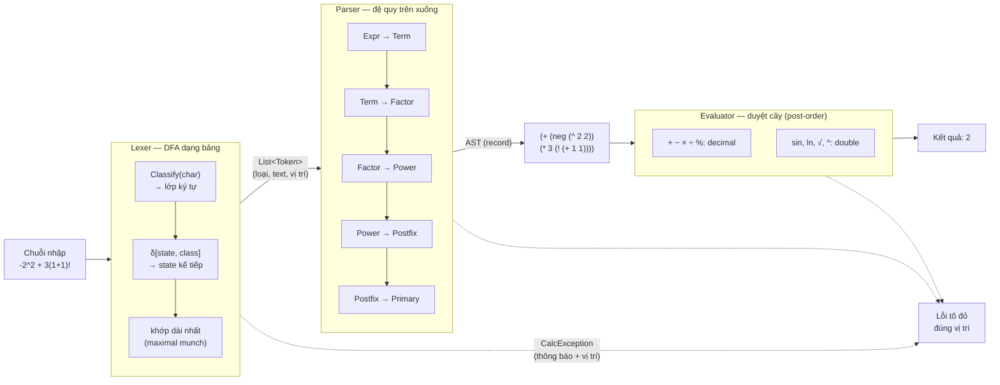
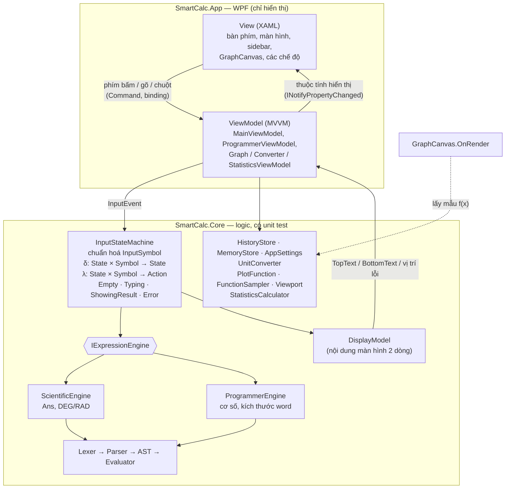

# SmartCalc

Máy tính cá nhân trên desktop (WPF, .NET 10), bài tập môn **Kiểm chứng mô hình**, Đại học Cần Thơ.

Điểm nhấn học thuật: biểu thức được xử lý bằng **lý thuyết ôtômat** (lexer là một DFA dạng bảng) và **phân tích cú pháp đệ quy trên xuống** (cho ra cây AST rồi duyệt để tính). Giao diện được điều khiển bằng một **máy trạng thái** dạng bảng chuyển tường minh. Dự án không dùng `DataTable.Compute`, không dùng thư viện parse biểu thức có sẵn, và không dùng Regex để tách token.

## Tính năng

6 chế độ ở sidebar bên trái, đổi bằng phím tắt **Alt+1 … Alt+6**:

| Chế độ | Nội dung |
|---|---|
| 1. Cơ bản | `+ − × ÷ %`, `±`, `⌫`, `C`, ngoặc, `Ans` |
| 2. Khoa học | `sin cos tan` (nút **2nd** cho hàm ngược), `ln log`, `x² xʸ √ n! π e 1/x`, \|x\| (trị tuyệt đối), **DEG/RAD** |
| 3. Lập trình | HEX/DEC/OCT/BIN hiển thị song song; `AND OR XOR NOT << >>`; kích thước **QWORD/DWORD/WORD/BYTE** (bù hai, tràn quay vòng) |
| 4. Vẽ đồ thị | tối đa 3 hàm `y = f(x)` với màu khác nhau; lưới và trục; lăn chuột để zoom quanh con trỏ, kéo để di chuyển, nhấp đúp để đặt lại; nét được **ngắt** tại điểm không xác định và tiệm cận |
| 5. Đổi đơn vị | độ dài, khối lượng (có lạng/yến/tạ), nhiệt độ, diện tích, thể tích, tốc độ, thời gian, dữ liệu (bit/byte, KB và KiB) |
| 6. Thống kê | n, tổng, trung bình, trung vị, mode, min, max, phương sai và độ lệch chuẩn (mẫu & tổng thể) |

Tính năng chung:
- **Màn hình 2 dòng:** dòng trên là biểu thức, dòng dưới là kết quả (khi đang gõ thì hiện kết quả xem trước). Khi có lỗi, dòng dưới hiện thông báo tiếng Việt và ký tự ở vị trí lỗi được **tô đỏ**.
- **Trình bày biểu thức:** Cơ bản/Khoa học hiển thị lũy thừa bằng chỉ số trên thật (hỗ trợ lồng nhau, ô nhạt khi đang nhập mũ) và `abs(...)` bằng dấu `|...|`, cả trên màn hình và trong lịch sử. Vị trí tô lỗi ánh xạ về chuỗi gốc. Chế độ Lập trình giữ text thô vì `^` là XOR. Biểu thức bên trong, JSON và Ctrl+C/Ctrl+V vẫn dùng text như `2^3`, `abs(-5)`; các ô nhập đồ thị/đổi đơn vị/thống kê giữ nguyên.
- **Bàn phím thật:** số, toán tử, Enter (=), Esc (C), Backspace, Ctrl+C / Ctrl+V.
- **Lịch sử** (lưu JSON) và **bộ nhớ** MC MR M+ M− MS ở panel phải.
- **Giao diện:** theme sáng/tối, nút ghim cửa sổ luôn trên cùng. Cửa sổ co giãn được: sidebar tự thu gọn và panel phải hiện đè lên khi cửa sổ hẹp.
- **Độ chính xác:** `+ − × ÷` tính bằng `decimal`, nên `0.1 + 0.2 = 0.3` chính xác. Hàm siêu việt dùng `double`. Kết quả hiển thị tối đa 15 chữ số có nghĩa.

## Cách chạy

Yêu cầu: **Windows 10/11** và **.NET SDK 10**.

```bash
dotnet build SmartCalc.sln                  # build (0 warning, warning bị coi là lỗi)
dotnet test SmartCalc.sln                   # chạy 6356 test
dotnet run --project src/SmartCalc.App      # mở ứng dụng
```

Dữ liệu người dùng được lưu trong `%AppData%\SmartCalc\`:
- `history.json`: lịch sử Queue, tối đa 100 mục; UI và JSON giữ thứ tự mới nhất trước;
- `settings.json`: theme, ghim, DEG/RAD, chế độ, kích thước cửa sổ, cơ số và kích thước word.

File hỏng hoặc bị sửa tay sai sẽ được bỏ qua, app dùng giá trị mặc định.
Cài đặt chế độ Thống kê cũ (`Mode = 7`) được đọc thành `Mode = 6`.

## Kiến trúc

Solution `SmartCalc.sln` gồm 3 project:

| Project | Vai trò |
|---|---|
| `src/SmartCalc.Core` (class library, `net10.0`) | **Toàn bộ logic**, không phụ thuộc giao diện |
| `src/SmartCalc.App` (WPF, `net10.0-windows`) | Giao diện MVVM (CommunityToolkit.Mvvm): chỉ binding và hiển thị |
| `tests/SmartCalc.Core.Tests` (xUnit) | Kiểm thử Core |

### Xử lý biểu thức: Lexer → Parser → AST → Evaluator



- **Lexer** (`Core/Lexing`): DFA M = (Q, Σ, δ, q0, F). Mọi luật số nằm trong bảng δ; trạng thái `BadNumber` sinh Error để token lỗi dài hơn thắng theo quy tắc khớp dài nhất. Giữ nguyên vị trí/thông báo lỗi và nhân ngầm ở chế độ thường. Có cấu hình lập trình cho cơ số 2/8/10/16. Xem [docs/dfa-lexer.md](docs/dfa-lexer.md).
- **Parser** (`Core/Parsing`): mỗi ký hiệu chưa kết thúc là một hàm `Parse*`. Văn phạm LL(1) đảm bảo thứ tự ưu tiên và tính kết hợp (`^` kết hợp phải, `-2^2 = -4`). Có giới hạn 256 mức lồng nhau để không tràn stack. Chế độ lập trình dùng `ProgrammerParser` với độ ưu tiên kiểu C. Xem [docs/grammar.md](docs/grammar.md).
- **Evaluator** (`Core/Evaluation`, `Core/Programmer`): duyệt AST; hàm tính được tra trong Dictionary tên → Func tại `Evaluation/FunctionTable`. `Parsing/Builtins` giữ tên hàm, hằng và bí danh. Bản số thực dùng decimal/double và DEG/RAD; bản số nguyên dùng bù hai theo kích thước word. Mọi lỗi được báo bằng `CalcException(thông báo tiếng Việt, vị trí)`.
- **Đọc số dùng chung:** Thống kê và Đổi đơn vị dùng `NumberReader` chạy DFA số của Lexer, sau đó chuyển giá trị decimal. Dấu âm, dấu phân tách và chuẩn hoá dữ liệu giữ nguyên.

### Giao diện: UI → StateMachine → Core



- **Máy nhập liệu toàn phần:** ViewModel gửi `InputEvent`; engine/kết quả sửa chuỗi được chuẩn hoá thành 10 `InputSymbol` trước khi tra bảng. Bảng chuyển trạng thái và bảng hành động riêng có đủ **40 ô mỗi bảng**, kể cả hàng Error; Process không gọi đệ quy. Có test giá trị từng ô và các kịch bản phím cũ. Xem [docs/state-machine.md](docs/state-machine.md).
- **Một bảng, nhiều chế độ:** phần tính toán được tách thành `IExpressionEngine`. Vì vậy Cơ bản/Khoa học (`ScientificEngine`) và Lập trình (`ProgrammerEngine`) dùng **cùng** máy trạng thái.
- **Các chế độ khác** (đổi đơn vị, đồ thị, thống kê) gọi thẳng các lớp tương ứng trong Core. Riêng `GraphCanvas` chỉ chuyển sự kiện chuột thành phép biến đổi `Viewport` và vẽ các đoạn do `FunctionSampler` trả về.

### Cấu trúc thư mục

```
SmartCalc.sln
Directory.Build.props          Nullable + TreatWarningsAsErrors cho mọi project
docs/                          SPEC, DFA lexer, văn phạm, máy trạng thái, báo cáo test
src/SmartCalc.Core/
  Lexing/        DFA (LexerDfa: bảng δ), Lexer (khớp dài nhất), Token, NumberReader
  Parsing/       Parser, ProgrammerParser, AST, ParserLimits, Builtins
  Evaluation/    Evaluator (decimal/double), Calculator, NumberFormatter
  Input/         InputStateMachine, IExpressionEngine, ExpressionEditor, DisplayModel, ExpressionLayout
  Programmer/    IntegerEvaluator (WordSize), ProgrammerFormatter, ProgrammerSession
  Graphing/      PlotFunction, FunctionSampler, Viewport, GridLines
  Statistics/    StatisticsCalculator
  Units/         UnitConverter
  History/ Memory/ Settings/ Persistence/ Formatting/ Errors/
src/SmartCalc.App/
  Views/         BasicKeypad, ScientificKeypad, ProgrammerView, GraphView, ConverterView,
                 StatisticsView, ExpressionDisplay, SidePanel
  ViewModels/    KeypadViewModel (dùng chung), MainViewModel và VM từng chế độ
  Controls/      GraphCanvas (vẽ bằng OnRender)
  Themes/        Light.xaml, Dark.xaml (bảng màu), Styles.xaml
tests/SmartCalc.Core.Tests/    6356 test, xem docs/test-report.md
```

## Tài liệu

| File | Nội dung |
|---|---|
| [docs/SPEC.md](docs/SPEC.md) | Đặc tả dự án |
| [docs/dfa-lexer.md](docs/dfa-lexer.md) | DFA của lexer: lớp ký tự, bảng chuyển trạng thái, sơ đồ nhận dạng số |
| [docs/grammar.md](docs/grammar.md) | Văn phạm, lý do văn phạm cho đúng thứ tự ưu tiên, ví dụ cây AST, văn phạm chế độ lập trình |
| [docs/state-machine.md](docs/state-machine.md) | Máy nhập liệu: bảng chuyển và bảng hành động 40 ô, sơ đồ, ví dụ |
| [docs/test-report.md](docs/test-report.md) | Số lượng test, các nhóm test, lỗi đã sửa |

## Giới hạn đã biết

- **Kích thước biểu thức:** lồng tối đa 256 mức, dài tối đa 1 000 ký hiệu. Vượt quá thì báo lỗi rõ ràng thay vì làm treo hoặc tắt chương trình.
- **Lượng giác:** đồ thị luôn tính lượng giác theo radian.
- **Thống kê:** dấu phẩy là dấu **phân tách** giữa các số; dấu thập phân phải là dấu chấm.
- **Phạm vi số:** số thực được giới hạn bởi `double` (khoảng ±1.8e308); đổi đơn vị và thống kê được giới hạn bởi `decimal` (khoảng ±7.9e28).
