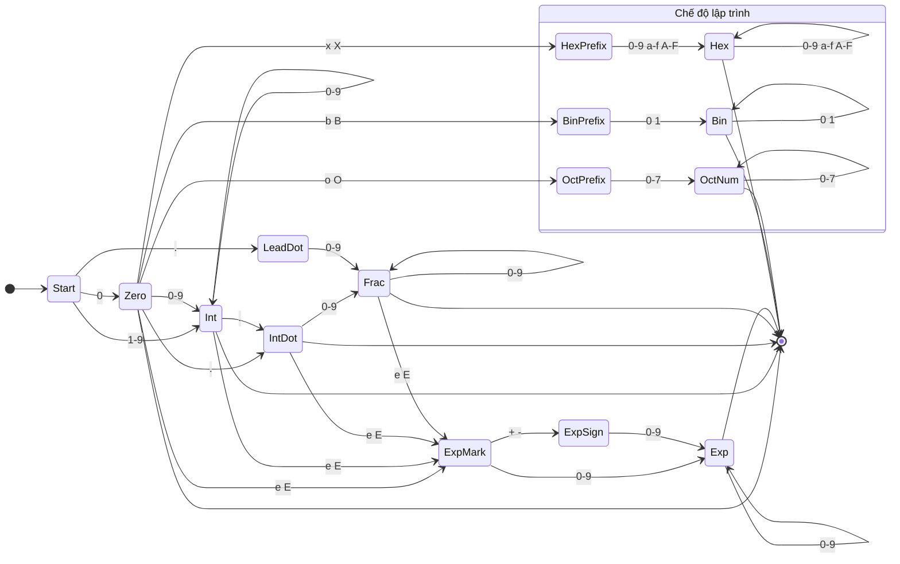

# Lexer SmartCalc — DFA dạng bảng

Code: `src/SmartCalc.Core/Lexing/LexerDfa.cs` (bảng δ), `Lexer.cs` (vòng lặp chạy DFA).
Test: `tests/SmartCalc.Core.Tests/Lexing/LexerTests.cs`.

## 1. Định nghĩa hình thức

**M = (Q, Σ, δ, q0, F)**

| Thành phần | Trong code |
|---|---|
| Q — tập trạng thái | `enum DfaState` |
| Σ — bảng chữ cái (gom thành lớp ký tự) | `enum CharClass`, hàm `LexerDfa.Classify(char)` |
| δ — hàm chuyển | ma trận `DfaState[,] _table`, truy cập qua `Next(state, cls)` |
| q0 — trạng thái bắt đầu | `DfaState.Start` |
| F — tập trạng thái kết thúc | `_accepting` (trạng thái → loại token) và `_skip` (khoảng trắng) |

Ô không được gán trong bảng có giá trị `Dead` (= 0): **không có cạnh**, DFA dừng.

## 2. Lớp ký tự (phân hoạch Σ)

Phải gom như vậy vì một ký tự có thể đóng nhiều vai trò: `e` vừa là ký hiệu số mũ, vừa là chữ số hex, vừa là chữ cái.

| Lớp | Ký tự | Vai trò |
|---|---|---|
| Zero | `0` | chữ số; mở đầu tiền tố 0x/0b/0o |
| One | `1` | chữ số (cả nhị phân) |
| Oct | `2`–`7` | chữ số (cả bát phân) |
| Dec | `8` `9` | chữ số thập phân |
| Dot | `.` | dấu thập phân |
| LetterE | `e` `E` | số mũ / chữ số hex / chữ cái |
| LetterB | `b` `B` | tiền tố 0b / chữ số hex / chữ cái |
| LetterO | `o` `O` | tiền tố 0o / chữ cái |
| LetterX | `x` `X` | tiền tố 0x / chữ cái (biến x) |
| HexLetter | `a c d f` (hoa/thường) | chữ số hex / chữ cái |
| Letter | các chữ ASCII còn lại | chữ cái |
| Symbol | `π` `√` | ký hiệu trên bàn phím (bí danh của `pi`, `sqrt`), luôn đứng riêng |
| Plus, Minus, Star, Slash, Caret, Percent, Bang | `+ - * / ^ % !` (và `− × ÷`) | toán tử |
| LParen, RParen, Comma | `( ) ,` | dấu câu |
| Amp, Pipe, Tilde, Less, Greater | `& \| ~ < >` | toán tử bit (chế độ lập trình) |
| Space | khoảng trắng | bỏ qua |
| Other | mọi ký tự khác | **ký tự lạ → lỗi** |

Ký hiệu viết tắt trong bảng: **D** = {Zero, One, Oct, Dec} (mọi chữ số), **L** = {LetterE, LetterB, LetterO, LetterX, HexLetter, Letter} (mọi chữ cái), **H** = D ∪ {LetterE, LetterB, HexLetter} (chữ số hex).

## 3. Bảng chuyển trạng thái δ

### 3.1. Số thập phân (chế độ thường)

Ngôn ngữ nhận dạng: `D+ ('.' D*)? ([eE] [+-]? D+)?  |  '.' D+ ([eE] [+-]? D+)?`

| Trạng thái | Zero | One/Oct/Dec | Dot | LetterE | Plus/Minus | Kết thúc? |
|---|---|---|---|---|---|---|
| **Start** | Zero | Int | LeadDot | (Ident) | (toán tử) | |
| **Zero** | Int | Int | IntDot | ExpMark | – | ✔ Number |
| **Int** | Int | Int | IntDot | ExpMark | – | ✔ Number |
| **IntDot** | Frac | Frac | – | ExpMark | – | ✔ Number |
| **LeadDot** | Frac | Frac | – | – | – | |
| **Frac** | Frac | Frac | – | ExpMark | – | ✔ Number |
| **ExpMark** | Exp | Exp | – | – | ExpSign | |
| **ExpSign** | Exp | Exp | – | – | – | |
| **Exp** | Exp | Exp | – | – | – | ✔ Number |

(`–` = Dead.) `Zero` tách khỏi `Int` để có chỗ rẽ nhánh sang tiền tố cơ số.

### 3.1b. Số nguyên theo cơ số (chế độ lập trình)

Ở chế độ lập trình, bảng δ **được dựng khác**: không có `.`/số mũ, mà là số nguyên viết theo cơ số đang chọn `Radix` (`new LexerDfa(programmerMode: true, radix)`), không cần tiền tố — vd ở hệ HEX gõ `FF`. Gọi **R** = tập lớp ký tự là chữ số của cơ số: hệ 2 = {Zero, One}, hệ 8 = {Zero, One, Oct}, hệ 10 = D, hệ 16 = H.

| Trạng thái | Zero | R  {Zero} | Kết thúc? |
|---|---|---|---|
| **Start** | Zero | RadixInt | |
| **Zero** | RadixInt | RadixInt | ✔ Number |
| **RadixInt** | RadixInt | RadixInt | ✔ Number |

- Cạnh từ Start theo R được dựng **sau** định danh nên ghi đè: ở hệ HEX, `A`…`F` bắt đầu một **số**, không phải tên.
- Tiền tố `0x`, `0o` luôn dùng được; `0b` **không** dùng ở hệ HEX (vì `B` là chữ số hex: `0B1` = 0xB1).
- Sau một số, nếu dính liền chữ/chữ số (vd `102` ở hệ BIN, `1A` ở hệ DEC, `1.5`) → lỗi "Số không hợp lệ" trỏ đúng ký tự sai.

### 3.2. Số có tiền tố (chỉ chế độ lập trình)

| Trạng thái | LetterX | LetterB | LetterO | {Zero, One} | Oct | Dec | {LetterE, LetterB, HexLetter} | Kết thúc? |
|---|---|---|---|---|---|---|---|---|
| **Zero** | HexPrefix | BinPrefix | OctPrefix | (Int) | (Int) | (Int) | | ✔ Number |
| **HexPrefix** | – | Hex | – | Hex | Hex | Hex | Hex | |
| **Hex** | – | Hex | – | Hex | Hex | Hex | Hex | ✔ Number |
| **BinPrefix** | – | – | – | Bin | – | – | – | |
| **Bin** | – | – | – | Bin | – | – | – | ✔ Number |
| **OctPrefix** | – | – | – | OctNum | OctNum | – | – | |
| **OctNum** | – | – | – | OctNum | OctNum | – | – | ✔ Number |

### 3.3. Định danh, khoảng trắng, toán tử

| Trạng thái | Cạnh | Kết thúc? |
|---|---|---|
| Start | L → Ident | |
| Ident | L → Ident | ✔ Identifier |
| Start | Symbol → SymbolIdent | |
| SymbolIdent | *(không có cạnh ra)*, nên `πAns` tách thành `π`, `Ans` | ✔ Identifier |
| Start | Space → Space | |
| Space | Space → Space | ✔ (bỏ qua, không sinh token) |
| Start | Plus → Plus, Minus → Minus, Star → Star, Slash → Slash, Caret → Caret, Percent → Percent, Bang → Bang, LParen → LParen, RParen → RParen, Comma → Comma | ✔ mỗi trạng thái đích sinh token cùng tên |
| Start | *(lập trình)* Amp → Amp, Pipe → Pipe, Tilde → Tilde | ✔ Ampersand / Pipe / Tilde |
| Start | *(lập trình)* Less → Less, Greater → Greater | Less, Greater: **không** kết thúc |
| Less | Less → ShiftLeft | ✔ ShiftLeft (`<<`) |
| Greater | Greater → ShiftRight | ✔ ShiftRight (`>>`) |
| Start | Other → Dead | ký tự lạ |

## 4. Sơ đồ DFA nhận dạng số

Trạng thái kết thúc có cạnh tới `[*]`. Nhánh 0x/0b/0o chỉ có ở chế độ lập trình.



Ví dụ chạy `1.5e-3`:
`Start –1→ Int –.→ IntDot –5→ Frac –e→ ExpMark –-→ ExpSign –3→ Exp` ✔ (test `Dfa_RecognizesScientificNumber_StepByStep`).

## 5. Thuật toán tách token (maximal munch)

```
pos = 0
while pos < len(input):
    q = Start; lastAccept = none
    i = pos
    while i < len(input) and δ(q, class(input[i])) ≠ Dead:
        q = δ(q, class(input[i])); i++
        if q ∈ F: lastAccept = (q, i)
    if lastAccept = none: báo lỗi tại pos
    nếu q của lastAccept không phải Space: sinh token input[pos..i), vị trí pos
    pos = i của lastAccept
thêm token End
```

Hệ quả của khớp dài nhất:
- `2e` → `2`, `e` (số mũ chưa đủ, lùi về `Int`; parser sẽ hiểu là 2·e).
- `2pi` → `2`, `pi` (nhân ngầm do parser xử lý).
- Chế độ thường: `0x` → `0`, `x`.

## 6. Báo lỗi (CalcException, Position 0-based)

| Tình huống | Ví dụ | Vị trí | Thông báo |
|---|---|---|---|
| Ký tự không có cạnh từ Start | `2 # 3` | 2 | Ký tự không hợp lệ '#' tại vị trí 2 |
| Có cạnh nhưng không tới được trạng thái kết thúc | `1 + . 2`, `1 < 2` (lập trình) | 4, 2 | Ký hiệu không hoàn chỉnh … |
| Số dính dấu chấm thừa | `1.2.3` | 3 | Số không hợp lệ … |
| Số có tiền tố dính chữ/số sai cơ số | `0b102`, `0xFG` | 4, 3 | Số không hợp lệ … |

Hai luật cuối được kiểm tra ngay sau khi cắt token Number (`Lexer.CheckNumberEnd`), vì theo maximal munch thuần thì `1.2.3` sẽ thành `1.2` + `.3`, dễ gây hiểu nhầm.
