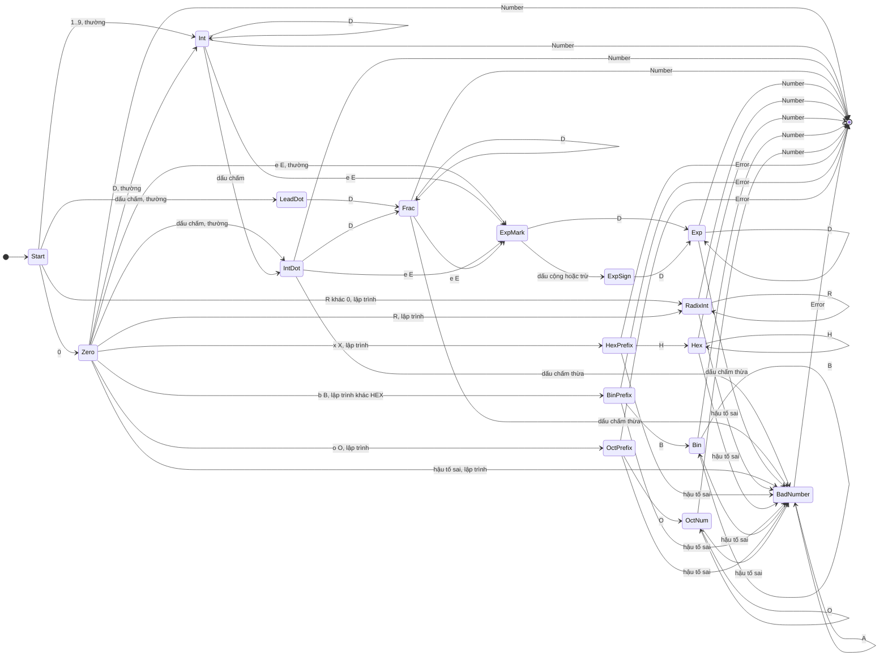

# Lexer SmartCalc — DFA thuần dạng bảng

Mã: `src/SmartCalc.Core/Lexing/LexerDfa.cs` (δ), `Lexer.cs` (khớp dài nhất),
`NumberReader.cs` (đọc một số decimal dùng chung DFA).

## 1. Mô hình

**M = (Q, Σ, δ, Start, F)**. Q gồm 38 giá trị của `DfaState`; Σ được phân thành 29
`CharClass`. δ là ma trận `[state, class]`. Mọi ô không ghi dưới đây có giá trị `Dead`;
mọi cạnh từ Dead cũng về Dead. Lexer dừng quét một token khi gặp Dead.

F ánh xạ trạng thái kết thúc sang Number, Identifier, toán tử hoặc **Error**; Space
là trạng thái kết thúc được bỏ qua. Không kiểm tra cú pháp số ngoài bảng δ.

## 2. Bảng chữ cái

| CharClass | Ký tự |
|---|---|
| Zero / One / Oct / Dec | `0` / `1` / `2`–`7` / `8`–`9` |
| Dot | `.` |
| LetterE / LetterB / LetterO / LetterX | `eE` / `bB` / `oO` / `xX` |
| HexLetter | `aAcCdDfF` |
| Letter | các chữ ASCII còn lại |
| Symbol | `π`, `√` |
| Plus / Minus / Star / Slash | `+` / `- −` / `* ×` / `/ ÷` |
| Caret / Percent / Bang | `^` / `%` / `!` |
| LParen / RParen / Comma | `(` / `)` / `,` |
| Amp / Pipe / Tilde / Less / Greater | `&` / `\|` / `~` / `<` / `>` |
| Space | `char.IsWhiteSpace` |
| Other | các ký tự còn lại |

Ký hiệu tập lớp: **D** = {Zero, One, Oct, Dec}; **L** = {LetterE, LetterB,
LetterO, LetterX, HexLetter, Letter}; **H** = D ∪ {LetterE, LetterB, HexLetter};
**B** = {Zero, One}; **O** = {Zero, One, Oct}; **A** = D ∪ L ∪ {Dot}.

## 3. Bảng δ

### Phần chung

| Trạng thái nguồn | Lớp vào | Trạng thái đích | Loại kết thúc ở đích |
|---|---|---|---|
| Start | L | Ident | Identifier |
| Ident | L | Ident | Identifier |
| Start | Symbol | SymbolIdent | Identifier |
| Start, Space | Space | Space | bỏ qua |
| Start | Plus, Minus, Star, Slash, Caret, Percent, Bang, LParen, RParen, Comma | trạng thái cùng tên lớp | token cùng tên |
| BadNumber | A | BadNumber | Error |

SymbolIdent không có cạnh ra; `πAns` luôn tách thành hai định danh.
Các cạnh Start → số của từng cấu hình bên dưới được ưu tiên hơn cạnh Start → Ident.

### Chế độ thường

Ngôn ngữ số: `(D+ ('.' D*)? | '.' D+) ([eE] [+-−]? D+)?`.
Các ô `–` là Dead. Cạnh Start theo các lớp không ghi ở đây dùng phần chung.

| Trạng thái | Zero | One/Oct/Dec | Dot | LetterE | Plus/Minus | Kết thúc |
|---|---|---|---|---|---|---|
| Start | Zero | Int | LeadDot | Ident | toán tử | – |
| Zero | Int | Int | IntDot | ExpMark | – | Number |
| Int | Int | Int | IntDot | ExpMark | – | Number |
| IntDot | Frac | Frac | **BadNumber** | ExpMark | – | Number |
| LeadDot | Frac | Frac | – | – | – | – |
| Frac | Frac | Frac | **BadNumber** | ExpMark | – | Number |
| ExpMark | Exp | Exp | – | – | ExpSign | – |
| ExpSign | Exp | Exp | – | – | – | – |
| Exp | Exp | Exp | **BadNumber** | – | – | Number |

Các trạng thái chỉ dành cho lập trình không có cạnh và không kết thúc ở cấu hình thường.

### Chế độ lập trình — từng cơ số

| Radix | Tập chữ số R không tiền tố | Zero theo LetterB |
|---|---|---|
| 2 | B | BinPrefix |
| 8 | O | BinPrefix |
| 10 | D | BinPrefix |
| 16 | H | RadixInt (`B` là chữ số hex) |

| Trạng thái | Cạnh hợp lệ | Mọi lớp trong A còn lại | Kết thúc |
|---|---|---|---|
| Start | Zero → Zero; R trừ Zero → RadixInt | dùng phần chung hoặc Dead | – |
| Zero | R → RadixInt; LetterX → HexPrefix; LetterO → OctPrefix; LetterB theo bảng trên | **BadNumber** | Number |
| RadixInt | R → RadixInt | **BadNumber** | Number |
| HexPrefix | H → Hex | **BadNumber** | **Error** |
| Hex | H → Hex | **BadNumber** | Number |
| BinPrefix | B → Bin (Radix khác 16) | **BadNumber** | **Error** |
| Bin | B → Bin (Radix khác 16) | **BadNumber** | Number |
| OctPrefix | O → OctNum | **BadNumber** | **Error** |
| OctNum | O → OctNum | **BadNumber** | Number |

Ở HEX, BinPrefix/Bin không thể tới từ Start; các ô A của chúng đều là BadNumber.
Các trạng thái thập phân Int/IntDot/LeadDot/Frac/ExpMark/ExpSign/Exp không có cạnh và không kết thúc.
Start không có cạnh theo chữ số sai cơ số: `2` ở BIN vẫn báo ký tự không hợp lệ tại 0.

| Cạnh toán tử chỉ có trong lập trình | Kết thúc |
|---|---|
| Start — Amp → Amp | Ampersand |
| Start — Pipe → Pipe | Pipe |
| Start — Tilde → Tilde | Tilde |
| Start — Less → Less — Less → ShiftLeft | chỉ ShiftLeft |
| Start — Greater → Greater — Greater → ShiftRight | chỉ ShiftRight |

## 4. Sơ đồ nhận số

Nhánh thập phân chỉ hoạt động ở chế độ thường; nhánh tiền tố chỉ hoạt động ở lập trình.
Trong lập trình, Zero/RadixInt dùng R; trong chế độ thường, Zero dùng D, Dot và LetterE.

## 5. Khớp dài nhất và lỗi

Lexer chạy từ Start, ghi nhớ trạng thái kết thúc cuối và vị trí kết thúc Number cuối.
Khi gặp Dead hoặc hết chuỗi, chọn kết thúc dài nhất. Nếu đó là Error, ném CalcException;
vị trí lỗi là ngay sau Number hợp lệ cuối. Việc ghi nhớ này chỉ phục vụ vị trí lỗi,
không kiểm tra chữ số hay quyết định số hợp lệ ngoài bảng.

| Ví dụ | Kết quả |
|---|---|
| `1.2.3` | token Error dài hơn `1.2`, lỗi tại 3 |
| `0b102` (lập trình) | Error, lỗi tại 4 |
| `0xFG` (lập trình) | Error, lỗi tại 3 |
| `0x`, `0xG` (lập trình) | Error, lỗi tại 1 (sau Number `0`) |
| `102` (BIN), `1A` (DEC) | Error, lỗi tại 2 / 1 |
| `2e`, `2e-x` (thường) | số mũ chưa đủ: lùi về `2`, rồi đọc `e`, … như trước |
| `2pi`, `3(4+1)`, `2sin(30)` (thường) | tách token để Parser thực hiện nhân ngầm |
| `0B1` (HEX) | một số hex, không phải tiền tố BIN |

Thông báo giữ nguyên: `Số không hợp lệ: ký tự 'c' tại vị trí p`. Ký tự không có cạnh
từ Start vẫn báo `Ký tự không hợp lệ 'c' tại vị trí p`; ký hiệu không tới kết thúc
vẫn báo `Ký hiệu không hoàn chỉnh 'c' tại vị trí p`. Position tính từ 0.

## 6. Đọc số dùng chung và kiểm thử

`NumberReader` tách dấu đầu `+`, `-`, `−`, chạy chính `LexerDfa` cấu hình thường trên
toàn bộ phần còn lại và chỉ nhận trạng thái Number. Sau đó `decimal.Parse` chuyển giá trị,
giữ nguyên phạm vi, làm tròn và hụt số của decimal. Nó không nhận các biểu thức nhân ngầm.
Thống kê giữ các dấu phân tách hiện có; Đổi đơn vị chuẩn hoá dấu phẩy/khoảng trắng trước khi gọi.

`LexerTableTests` kiểm từng ô của 5 cấu hình: **38 × 29 × 5 = 5.510 ô**, kể cả Dead
và các trạng thái không tới được, cùng tập kết thúc/bỏ qua. `NumberDifferentialTests`
đối chiếu DFA và đường Lexer với Regex độc lập trên **20.000 chuỗi mỗi cấu hình**,
seed cố định, tổng 100.000 chuỗi. Regex chỉ nằm trong project test.
