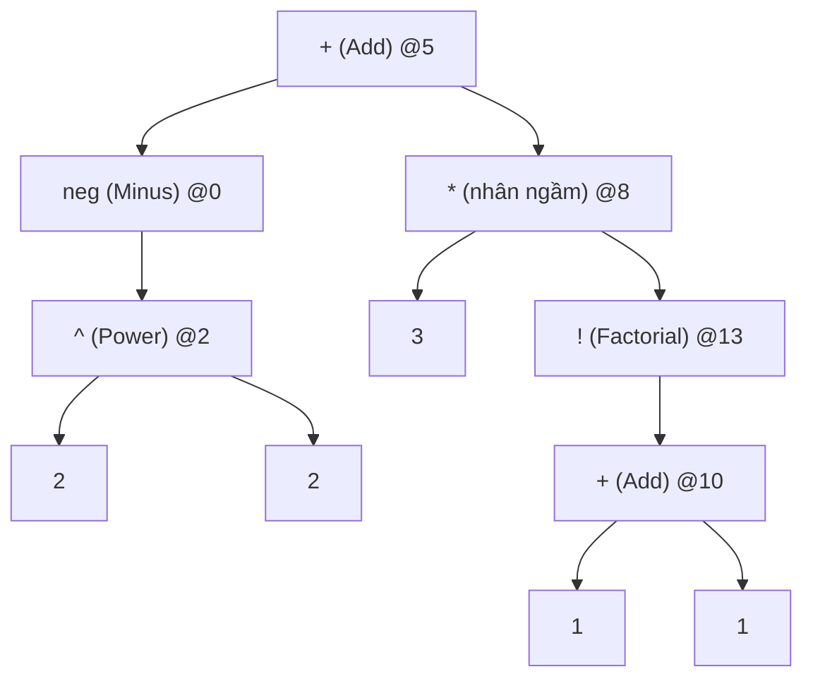

# Văn phạm biểu thức SmartCalc

Code: `src/SmartCalc.Core/Parsing/Parser.cs` (parser đệ quy trên xuống), `Ast.cs` (các nút AST),
`src/SmartCalc.Core/Evaluation/Evaluator.cs` (duyệt AST để tính giá trị).
Test: `tests/SmartCalc.Core.Tests/Parsing/ParserTests.cs`, `Evaluation/EvaluatorTests.cs`, `Evaluation/ErrorTests.cs`.

Luồng xử lý: chuỗi → **Lexer (DFA)** → danh sách token → **Parser** → **AST** → **Evaluator** → số.

## 1. Văn phạm (EBNF)

Ký hiệu kết thúc là các token của lexer (`Number`, `Identifier`, `+`, `(` …). Các tầng được sắp từ độ ưu tiên **thấp nhất** (trên cùng) tới **cao nhất** (dưới cùng):

```
Expr     -> Term ( ('+' | '-') Term )*
Term     -> Factor ( ('*' | '/' | '%') Factor | Implicit )*
Implicit -> Factor              -- chỉ khi token kế tiếp là Identifier hoặc '('
Factor   -> ('-' | '+') Factor | Power
Power    -> Postfix ( '^' Factor )?
Postfix  -> Primary '!'*
Primary  -> Number
          | Constant                       -- pi | e | Ans
          | Variable                       -- x (chỉ khi vẽ đồ thị)
          | Func '(' Expr ')'              -- sin cos tan asin acos atan ln log sqrt abs fact
          | '(' Expr ')'
```

Mỗi ký hiệu chưa kết thúc ứng với **một hàm** trong `Parser.cs`: `ParseExpr`, `ParseTerm`, `ParseFactor`, `ParsePower`, `ParsePostfix`, `ParsePrimary`. Hàm nào chỉ cần nhìn **một token** phía trước để chọn nhánh, nên đây là văn phạm **LL(1)**: không cần quay lui.

### Khác biệt so với SPEC

SPEC ghi:

```
Factor -> Unary ('^' Factor)?
Unary  -> ('-'|'+') Unary | Postfix
```

Với văn phạm đó, `-2^2` sẽ được phân tích thành `Factor -> Unary(-2) '^' Factor(2)`, tức `(-2)^2 = 4`, mâu thuẫn với quy ước toán học và yêu cầu `-2^2 = -4`. Ta **đảo hai tầng**: dấu một ngôi (`Factor`) nằm *trên* luỹ thừa (`Power`), nên `-2^2 = -(2^2) = -4`. Vế phải của `^` vẫn là `Factor`, nên `2^-1 = 0.5` vẫn hợp lệ.

## 2. Vì sao văn phạm này cho đúng thứ tự ưu tiên

**Nguyên tắc:** toán tử nằm ở tầng càng **sâu** (gần `Primary`) thì càng được **gắn chặt** vào toán hạng, tức ưu tiên càng **cao**.

Lý do: muốn ra một `Term` cho `Expr` dùng, parser phải dựng xong mọi `Factor` bên trong `Term` đó trước. Vì thế `*` luôn "nhóm" toán hạng trước khi `+` kịp nhìn thấy chúng. Trong cây AST, toán tử ưu tiên cao nằm **dưới thấp** hơn, nên được tính **trước** (Evaluator tính con trước cha).

| Tầng | Toán tử | Ưu tiên | Kết hợp | Lý do kết hợp |
|---|---|---|---|---|
| Expr | `+ -` | 1 (thấp nhất) | trái | vòng lặp `( … )*` gắn dần vào `left` |
| Term | `* / %`, nhân ngầm | 2 | trái | như trên |
| Factor | `-x +x` (một ngôi) | 3 | phải | `Factor -> '-' Factor` đệ quy phải |
| Power | `^` | 4 | **phải** | `Power -> Postfix '^' Factor` đệ quy ở vế **phải** |
| Postfix | `!` | 5 (cao nhất) | trái | vòng lặp `'!'*` |

**Kết hợp trái** (`10-2-3`): `ParseExpr` dùng vòng lặp `left = new BinaryNode(op, left, right)`. Mỗi lần lặp đặt cây cũ làm con **trái**, cho ra `((10-2)-3) = 5`.

**Kết hợp phải** (`2^3^2`): `ParsePower` đọc `2`, gặp `^`, rồi gọi đệ quy `ParseFactor` cho phần còn lại `3^2`. Phần đó trở thành con **phải**, cho ra `2^(3^2) = 512`.

**Không mơ hồ:** mỗi chuỗi hợp lệ chỉ có đúng một cây dẫn xuất. Mỗi tầng chỉ gọi xuống tầng sâu hơn, chỉ trở lại tầng nông qua cặp ngoặc `'(' Expr ')'`, và không tầng nào có hai cách triển khai cùng bắt đầu bằng một token.

**Không đệ quy trái:** dạng sách giáo khoa `Expr -> Expr '+' Term` sẽ làm parser đệ quy trên xuống lặp vô hạn. Ta viết lại thành `Expr -> Term ('+' Term)*` (lặp), cùng ngôn ngữ, cùng tính kết hợp trái.

### Ví dụ dẫn xuất ngắn: `2+3*4`

```
Expr => Term '+' Term
     => Factor '+' Factor '*' Factor        -- '*' bị "nhốt" trong Term thứ hai
     => 2 '+' 3 '*' 4
AST:  (+ 2 (* 3 4))  =  2 + 12 = 14
```

### Nhân ngầm

Trong vòng lặp của `ParseTerm`, nếu token kế tiếp là `Identifier` hoặc `(` (tức là đầu của một `Factor` mới, không phải toán tử), parser coi như có dấu `*` ẩn: `2pi`, `3(4+1)`, `(1+1)(2+2)`, `2sin(30)`. Vì nằm ở tầng `Term`, nhân ngầm có **cùng ưu tiên** với `*`: `2pi^2 = 2·(pi^2)`, `1+2pi = 1+(2·pi)`.

Một số **đứng sau** một Factor (`2 3`, `(1)2`) **không** được nhân ngầm mà báo lỗi "Thiếu toán tử", để tránh hiểu sai khi gõ nhầm.

## 3. Ví dụ cây AST: `-2^2 + 3(1+1)!`

Cây in dạng tiền tố (`AstPrinter.ToPrefix`): `(+ (neg (^ 2 2)) (* 3 (! (+ 1 1))))`. Có test kiểm tra đúng chuỗi này trong `ParserTests`.



(`@n` = `Position` của nút, dùng để báo lỗi.)

Cây này cho thấy:
- `^` nằm **dưới** `neg`, nên `-2^2 = -(4)`, không phải `(-2)^2`.
- `!` gắn vào cả nhóm `(1+1)` vì `Postfix -> Primary '!'*` và `(1+1)` là một `Primary`.
- Nhân ngầm `3(…)` tạo nút `*` như phép nhân thường (cờ `Implicit = true`).
- `+` ở gốc vì nó có ưu tiên thấp nhất, nên được tính **sau cùng**.

Giá trị: `-(2^2) + 3·(1+1)! = -4 + 3·2 = 2`.

## 4. Evaluator

Duyệt AST theo thứ tự sau (post-order): tính các con rồi áp toán tử ở nút cha.

- **Kiểu số:** `+ - * / %` và `^` với số mũ nguyên tính bằng `decimal` (cơ số 10), nên `0.1+0.2 = 0.3` chính xác. Hàm siêu việt (`sin`, `ln`, `sqrt`, `^` với số mũ không nguyên) dùng `double`.
  - double được đổi sang decimal qua chuỗi round-trip `"R"`, giữ đủ 17 chữ số. Phép ép `(decimal)x` chỉ giữ 15 chữ số, sẽ làm `pi` và `1/3` mất chữ số.
  - Chỉ dùng decimal khi toán hạng và kết quả có trị tuyệt đối trong `[1e-10, 1e27]` (hoặc bằng 0). Ngoài khoảng này, decimal sẽ tràn hoặc mất chữ số có nghĩa, nên chuyển sang double.
- **Góc:** `EvalContext.AngleMode` là `Deg` (mặc định) hoặc `Rad`. Ở DEG, góc được rút gọn theo 360° trước khi đổi sang radian. Giá trị lượng giác có độ lớn `< 1e-15` được làm tròn về 0, nên `sin(180) = 0`.
- **Hiển thị:** `NumberFormatter.Format` hiện tối đa 15 chữ số có nghĩa (`0.30000000000000004` → `0.3`).
- **Ngữ cảnh:** `Ans` lấy từ `EvalContext.Ans`, biến `x` lấy từ `EvalContext.X`. Parser chỉ cho dùng `x` khi `X` có giá trị.

## 5. Lỗi (CalcException: thông báo tiếng Việt + Position 0-based)

| Lỗi | Ví dụ | Vị trí trỏ vào |
|---|---|---|
| Ký tự lạ | `2 # 3` | 2: ký tự `#` |
| Thiếu `)` | `2*(3+(4-1)` | 2: dấu `(` chưa được đóng |
| Thừa `)` | `2+3)` | 3: dấu `)` thừa |
| Thiếu toán hạng | `2+`, `*3`, `()` | 2 (cuối chuỗi), 0, 1 |
| Thiếu toán tử | `2 3` | 2: số thứ hai |
| Chia cho 0 | `5 / (2-2)`, `5%0`, `0^-1` | dấu `/`, `%`, `^` |
| Miền xác định | `sqrt(-1)`, `ln(0)`, `asin(2)`, `tan(90)`, `(-8)^(1/3)` | tên hàm / dấu `^` |
| Giai thừa | `2.5!`, `(-3)!` (không nguyên/âm), `171!` (quá lớn) | dấu `!` |
| Tràn số | `10^400`, `1e400`, `1e300*1e300` | toán tử / literal |
| Tên sai | `foo(2)`, `sin 30`, `2x` (ngoài chế độ đồ thị) | tên / vị trí thiếu `(` |

## 6. Văn phạm chế độ Lập trình

Code: `src/SmartCalc.Core/Parsing/ProgrammerParser.cs`, `src/SmartCalc.Core/Programmer/IntegerEvaluator.cs`. Lexer chạy ở chế độ lập trình với cơ số đang chọn (xem `docs/dfa-lexer.md` mục 3.1b). Độ ưu tiên giống ngôn ngữ C, mọi toán tử hai ngôi kết hợp trái:

```
Expr    -> Or
Or      -> Xor   ( '|' Xor )*                  OR
Xor     -> And   ( '^' And )*                  XOR  ('^' không còn là luỹ thừa)
And     -> Shift ( '&' Shift )*                AND
Shift   -> Sum   ( ('<<' | '>>') Sum )*
Sum     -> Product ( ('+' | '-') Product )*
Product -> Unary ( ('*' | '/' | '%') Unary )*
Unary   -> ('-' | '+' | '~') Unary | Primary     '~' = NOT
Primary -> Number | '(' Expr ')'
```

Sáu tầng hai ngôi cùng một khuôn `Tầng_i -> Tầng_(i+1) (op_i Tầng_(i+1))*`, nên được cài bằng **một** hàm `ParseLevel(i)` duyệt mảng `Levels` (mỗi phần tử là bảng token → toán tử của một tầng). Vẫn là đệ quy trên xuống: `ParseLevel(i)` gọi `ParseLevel(i+1)` đúng như vế phải luật sinh. Ví dụ: `1|2^3&4` → `(| 1 (xor 2 (& 3 4)))`.

**Số học theo kích thước word** (`WordSize`: BYTE 8, WORD 16, DWORD 32, QWORD 64 bit, có dấu, bù hai):

| Quy tắc | Ví dụ |
|---|---|
| Literal phải vừa số bit (không dấu) | BYTE: `FF` hợp lệ (= −1), `100` hex → lỗi tràn số |
| Mọi kết quả cắt về số bit rồi mở rộng dấu (quay vòng như C) | BYTE: `127+1 = −128`, `200*2 = −112` |
| `~` đảo bit trong word | BYTE: `~F0 = 0F` |
| `/`, `%` chia nguyên làm tròn về 0; chia 0 → lỗi | `−7/2 = −3`, `−7%3 = −1` |
| `>>` dịch số học (giữ bit dấu); dịch ≥ số bit: `<<` cho 0, `>>` cho 0 hoặc −1 | `−16>>2 = −4` |
| Đổi kích thước word: giá trị đang hiện bị cắt bớt bit cao | 300 → BYTE = 44 |

HEX/OCT/BIN hiển thị dãy bit bù hai trong word (BYTE −1 = `FF`), DEC hiển thị số có dấu. Chế độ Lập trình dùng **chung bảng máy trạng thái nhập liệu** với chế độ Khoa học (`docs/state-machine.md`), chỉ khác engine tính (`ProgrammerEngine`).
