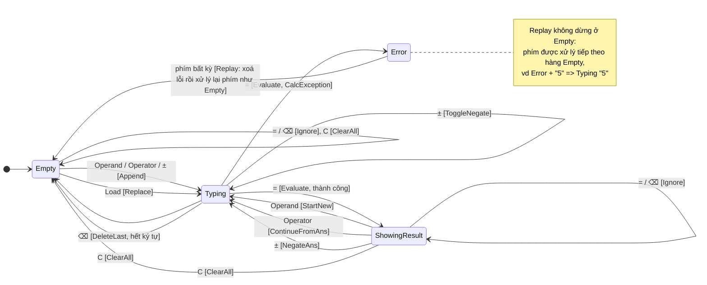

# Máy trạng thái nhập liệu (InputStateMachine)

Code: `src/SmartCalc.Core/Input/InputStateMachine.cs` (bảng chuyển trạng thái), `ExpressionEditor.cs` (thao tác chuỗi).
Test: `tests/SmartCalc.Core.Tests/Input/InputStateMachineTests.cs`, `ExpressionEditorTests.cs`.

Giao diện (WPF) **không tự quyết định** khi nào xoá màn hình, khi nào nối "Ans"… Nó chỉ biến mỗi phím bấm thành một `InputEvent` rồi gọi `Process()`. Mọi hành vi nằm trong bảng dưới đây.

## 1. Mô hình

Đây là một **máy Mealy**: đầu ra (hành động) gắn trên **cạnh** chứ không gắn trên trạng thái.

**M = (Q, Σ, Λ, δ, λ, q0)**

| Thành phần | Trong code |
|---|---|
| Q: trạng thái | `InputState` = { Empty, Typing, ShowingResult, Error } |
| Σ: bảng chữ cái vào (lớp phím) | `InputKind` = { Operand, Operator, Equals, Clear, Backspace, Negate, Load } |
| Λ: bảng chữ cái ra (hành động) | `InputAction` = { Append, StartNew, ContinueFromAns, Evaluate, ClearAll, DeleteLast, ToggleNegate, NegateAns, Replace, Replay, Ignore } |
| δ, λ: hàm chuyển + hàm xuất | `InputStateMachine.Table[(state, kind)] = Transition(Action, Next, OnFailure)` |
| q0 | `Empty` |

### Lớp phím

| InputKind | Phím |
|---|---|
| Operand | chữ số, `.`, `π`, `e`, `Ans`, hàm `sin(` `√(` …, `(`: **bắt đầu** một toán hạng |
| Operator | `+ − × ÷ ^ % ! )`, `x²` (`^2`), `1/x` (`^(−1)`): **cần** toán hạng bên trái |
| Equals | `=`, Enter |
| Clear | `C`, Esc, Delete |
| Backspace | `⌫`, Backspace |
| Negate | `±` |
| Load | bấm một dòng trong Lịch sử |

`InputEvent.FromText()` phân lớp text theo ký tự đầu tiên. Bàn phím ảo, bàn phím thật và Ctrl+V đều đi qua cùng một đường này.

### Điều kiện canh (guard)

Một số hành động có thể thất bại; khi đó máy đi theo cột **OnFailure**:
- `Evaluate`: tính thành công → `ShowingResult`; ném `CalcException` → `Error` (lưu thông báo + vị trí lỗi).
- `DeleteLast`, `Replace`: biểu thức còn ký tự → `Typing`; rỗng → `Empty`.

Có test bảo đảm **chỉ** ba hành động này có OnFailure, và bảng có **đủ 4 × 7 = 28 ô**. Nhờ vậy không có cặp (trạng thái, phím) nào bị bỏ sót, và `Process()` không cần if-else theo trạng thái.

## 2. Bảng chuyển trạng thái

Ô ghi: `hành động → trạng thái kế` (`| trạng thái khi thất bại`).

| Trạng thái \ Phím | Operand | Operator | Equals | Clear | Backspace | Negate | Load |
|---|---|---|---|---|---|---|---|
| **Empty** | Append → Typing | Append → Typing | Ignore → Empty | ClearAll → Empty | Ignore → Empty | Append "−" → Typing | Replace → Typing \| Empty |
| **Typing** | Append → Typing | Append → Typing | **Evaluate → ShowingResult \| Error** | ClearAll → Empty | DeleteLast → Typing \| Empty | ToggleNegate → Typing | Replace → Typing \| Empty |
| **ShowingResult** | **StartNew → Typing** | **ContinueFromAns → Typing** | Ignore → ShowingResult | ClearAll → Empty | Ignore → ShowingResult | NegateAns → Typing | Replace → Typing \| Empty |
| **Error** | **Replay** | **Replay** | **Replay** | **Replay** | **Replay** | **Replay** | **Replay** |

`Replay` = xoá lỗi, về `Empty`, rồi **xử lý lại chính phím đó** bằng hàng Empty (đúng quy tắc "Error + phím bất kỳ → xoá lỗi, xử lý như Empty" trong SPEC). Ví dụ: đang lỗi mà gõ `5`, máy sang Empty rồi Append, kết quả là Typing `"5"`.

Các quy tắc trong SPEC ứng với những ô **in đậm**:

| SPEC | Ô trong bảng |
|---|---|
| ShowingResult + gõ số → biểu thức mới | (ShowingResult, Operand) = StartNew |
| ShowingResult + gõ toán tử → nối tiếp từ "Ans" | (ShowingResult, Operator) = ContinueFromAns, tức biểu thức = `"Ans" + toán tử` |
| Error + phím bất kỳ → xoá lỗi, xử lý như Empty | cả hàng Error = Replay |
| '=' khi Typing → ShowingResult hoặc Error | (Typing, Equals) = Evaluate với guard |

## 3. Sơ đồ trạng thái

(Load từ Typing/ShowingResult cũng là `Replace → Typing`; để sơ đồ gọn nên chỉ vẽ từ Empty.)

## 4. Ví dụ chạy

| Phím | Trạng thái sau | Biểu thức | Dòng dưới |
|---|---|---|---|
| (bắt đầu) | Empty | | 0 |
| `2` | Typing | `2` | 2 (xem trước) |
| `+` `3` `×` `4` | Typing | `2+3×4` | 14 (xem trước) |
| `=` | ShowingResult | `2+3×4 =` | **14** (Ans = 14, ghi lịch sử) |
| `×` | Typing | `Ans×` | (chưa hợp lệ) |
| `2` `=` | ShowingResult | `Ans×2 =` | **28** (lịch sử ghi `14×2`) |
| `7` | Typing | `7` | 7: biểu thức mới |
| `÷` `0` `=` | Error | `7÷0` (dấu `÷` tô đỏ) | Không thể chia cho 0 (vị trí 1) |
| `1` | Typing | `1` | 1: lỗi bị xoá, phím được xử lý như Empty |

## 5. Chi tiết hành động

| Hành động | Tác dụng |
|---|---|
| Append | nối text. Toán tử hai ngôi gõ ngay sau toán tử hai ngôi sẽ **thay** toán tử cũ (`2+` rồi `×` → `2×`), trừ dấu `−` (để gõ được `2×−3`) |
| StartNew | biểu thức = text, xoá kết quả cũ |
| ContinueFromAns | biểu thức = `"Ans" + text` |
| NegateAns | biểu thức = `"−Ans"` |
| ToggleNegate | `e` ↔ `−(e)` |
| DeleteLast | xoá cả tên hàm/hằng một lần (`sin(` → ``, `Ans` → ``), còn lại xoá 1 ký tự |
| Evaluate | `Calculator.Evaluate` với DEG/RAD và Ans hiện tại. Thành công thì cập nhật Ans và phát sự kiện `Evaluated(biểu thức, kết quả)` để ghi lịch sử; trong biểu thức ghi lịch sử, `Ans` được thay bằng giá trị thật (`Ans×2` → `14×2`) để nạp lại sau này vẫn ra đúng |
| Replace | biểu thức = text (nạp từ lịch sử) |
| Replay | ClearAll, về Empty, gọi lại `Process` với cùng phím |

Ngoài bảng, máy còn tính **xem trước** (`Preview`) mỗi khi ở Typing: thử `Evaluate`, lỗi thì để trống. `CurrentValue` (giá trị cho M+, M−, MS) là Ans khi ở ShowingResult, giá trị xem trước khi ở Typing, và null trong các trường hợp còn lại.

## 6. Một bảng, nhiều chế độ: engine tính toán

Bảng chuyển trạng thái **không** gọi thẳng bộ tính. Phần "tính biểu thức" được tách thành interface `IExpressionEngine` (`src/SmartCalc.Core/Input/ExpressionEngine.cs`):

| Thao tác | ScientificEngine (Cơ bản/Khoa học) | ProgrammerEngine (Lập trình) |
|---|---|---|
| `Evaluate(expr)` | Lexer → Parser → Evaluator (decimal/double), có DEG/RAD | Lexer (theo cơ số) → ProgrammerParser → IntegerEvaluator (theo WordSize) |
| `Commit(result)` | Ans = kết quả | ghi nhớ giá trị cuối |
| `AnsText` (dùng cho ContinueFromAns, NegateAns) | `"Ans"` | chính giá trị theo cơ số đang nhập, vd `"F0"` (ở hệ HEX, chữ `A` là chữ số nên không dùng tên Ans) |
| `ForHistory(expr)` | thay `Ans` bằng giá trị thật | giữ nguyên |

Nhờ vậy chế độ Lập trình có **đúng cùng** hành vi nhập liệu (Error + phím bất kỳ, nối tiếp sau `=`, xoá lùi, đổi dấu…) mà không phải chép lại bảng. `ProgrammerSession` (Core) thêm các thao tác riêng: đổi cơ số nhập (viết lại giá trị đang hiện theo cơ số mới) và đổi kích thước word (cắt bớt bit cao).

`DisplayModel.From(machine)` suy ra nội dung màn hình 2 dòng từ trạng thái máy, dùng chung cho mọi chế độ có bàn phím.
