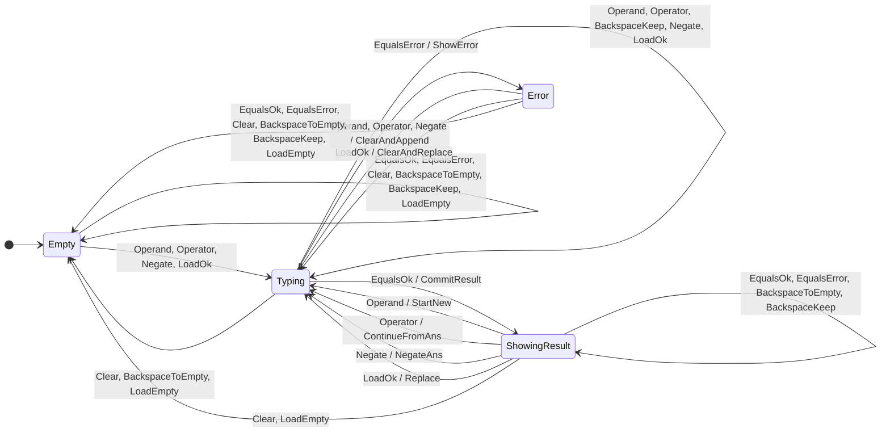

# Máy trạng thái nhập liệu (InputStateMachine)

Mã: `src/SmartCalc.Core/Input/InputStateMachine.cs`, `ExpressionEditor.cs`, `ExpressionEngine.cs`.
Test: `tests/SmartCalc.Core.Tests/Input/`.

## 1. Mô hình và chuẩn hoá đầu vào

Máy Mealy **M = (Q, Σ, Λ, δ, λ, Empty)** có 4 trạng thái Q = {Empty, Typing,
ShowingResult, Error}. δ là hàm toàn phần **Q × Σ → Q**, bảng `Table` chỉ đọc;
λ là bảng hành động `ActionTable` độc lập, cũng toàn phần. Mỗi bảng có **40 ô**.

UI gửi 7 loại phím `InputKind` qua `InputEvent`. Trước khi tra bảng, `Prepare` chuyển
chúng thành 10 ký hiệu `InputSymbol`; không cập nhật trạng thái hay ghi Ans ở bước này.

| Phím thô | Chuẩn hoá thành ký hiệu | Dữ liệu mang theo |
|---|---|---|
| Operand | Operand | text số, hằng, hàm, ngoặc mở |
| Operator | Operator | text toán tử, hậu tố, ngoặc đóng |
| Equals khi Typing | EqualsOk / EqualsError | EngineResult / CalcException của lần tính |
| Equals ở trạng thái khác | EqualsOk | không tính, không có kết quả mới |
| Clear | Clear | rỗng |
| Backspace khi Typing | BackspaceToEmpty / BackspaceKeep | biểu thức sau DeleteLast, dựa trên độ dài |
| Backspace ở trạng thái khác | BackspaceToEmpty | không sửa biểu thức; bảng quyết định tác dụng |
| Negate | Negate | `−` |
| Load | LoadEmpty / LoadOk | toàn bộ text nạp, dựa trên độ dài |

FromText phân loại theo ký tự đầu; toán tử `+ − × ÷ ^ % ! ) & \| << >>` là Operator,
`~` một ngôi là Operand. Bàn phím thật, nút bấm và dán text dùng chung đường xử lý.

## 2. Bảng chuyển δ

Mọi ô đều ghi trạng thái đích, kể cả các cặp không sinh ra trong thao tác bình thường.

| Q \ Σ | Operand | Operator | EqualsOk | EqualsError | Clear | BackspaceToEmpty | BackspaceKeep | Negate | LoadEmpty | LoadOk |
|---|---|---|---|---|---|---|---|---|---|---|
| Empty | Typing | Typing | Empty | Empty | Empty | Empty | Empty | Typing | Empty | Typing |
| Typing | Typing | Typing | ShowingResult | Error | Empty | Empty | Typing | Typing | Empty | Typing |
| ShowingResult | Typing | Typing | ShowingResult | ShowingResult | Empty | ShowingResult | ShowingResult | Typing | Empty | Typing |
| Error | Typing | Typing | Empty | Empty | Empty | Empty | Empty | Typing | Empty | Typing |

## 3. Bảng hành động λ

| Q \ Σ | Operand | Operator | EqualsOk | EqualsError | Clear | BackspaceToEmpty | BackspaceKeep | Negate | LoadEmpty | LoadOk |
|---|---|---|---|---|---|---|---|---|---|---|
| Empty | Append | Append | Ignore | Ignore | ClearAll | Ignore | Ignore | Append | Replace | Replace |
| Typing | Append | Append | CommitResult | ShowError | ClearAll | DeleteLast | DeleteLast | ToggleNegate | Replace | Replace |
| ShowingResult | StartNew | ContinueFromAns | Ignore | Ignore | ClearAll | Ignore | Ignore | NegateAns | Replace | Replace |
| Error | ClearAndAppend | ClearAndAppend | ClearAll | ClearAll | ClearAll | ClearAll | ClearAll | ClearAndAppend | ClearAndReplace | ClearAndReplace |

| Hành động | Tác dụng |
|---|---|
| Ignore | giữ dữ liệu |
| Append | ExpressionEditor.Append; giữ quy tắc thay toán tử trước, ngoại lệ dấu trừ cho `2×−3` |
| StartNew / Replace | biểu thức = text, xoá kết quả cũ |
| ContinueFromAns | biểu thức = Engine.AnsText + text, xoá kết quả cũ |
| NegateAns | biểu thức = `−` + Engine.AnsText, xoá kết quả cũ |
| ToggleNegate | đổi `e` ↔ `−(e)` |
| DeleteLast | gán biểu thức đã chuẩn bị; xoá cả tên hàm/hằng hoặc một ký tự như trước |
| CommitResult | lấy ForHistory trước Commit; ghi kết quả/Ans, xoá lỗi, phát Evaluated đúng một lần |
| ShowError | giữ biểu thức, xoá kết quả cũ, lấy nguyên Message/Position từ CalcException |
| ClearAll | xoá biểu thức, kết quả và lỗi; không xoá Ans của engine |
| ClearAndAppend | ClearAll rồi Append trong cùng hành động |
| ClearAndReplace | ClearAll rồi gán biểu thức nạp |

Không có cột OnFailure, hành động Replay hoặc gọi lại Process. Hàng Error xử lý trực tiếp
từng ký hiệu nên `Error + 5` chuyển thẳng thành Typing với biểu thức `5`.

Process chuẩn bị đầu vào, tra δ và λ bằng cùng khoá, thực thi hành động, gán trạng thái
đã tra rồi cập nhật Preview. Hành động không trả kết quả thành công/thất bại để chọn nhánh.

## 4. Sơ đồ trạng thái

## 5. Ví dụ và engine

| Phím | Trạng thái | Biểu thức | Kết quả |
|---|---|---|---|
| `2+3×4` | Typing | `2+3×4` | Preview 14 |
| `=` → EqualsOk | ShowingResult | `2+3×4` | 14; ghi lịch sử |
| `×2` | Typing | `Ans×2` | Preview 28 |
| `=` | ShowingResult | `Ans×2` | 28; lịch sử ghi `14×2` |
| `7÷0` rồi `=` → EqualsError | Error | `7÷0` | Không thể chia cho 0 (vị trí 1) |
| `1` | Typing | `1` | Preview 1, lỗi đã xoá |
| Backspace → BackspaceToEmpty | Empty | rỗng | 0 |

`IExpressionEngine.Evaluate` không đổi Ans; chỉ CommitResult gọi Commit.
ScientificEngine giữ DEG/RAD và AnsText = `Ans`. ProgrammerEngine giữ cơ số/word,
AnsText là giá trị theo cơ số hiện tại. Cả hai dùng cùng hai bảng.

Preview thử Evaluate khi Typing, lỗi thì để trống. CurrentValue là kết quả vừa tính khi
ShowingResult, Preview khi Typing, còn lại null. DisplayModel suy ra màn hình hai dòng.

`InputTableTests` kiểm giá trị **từng ô của cả hai bảng**, 32 kịch bản phím/nạp từ mọi
trạng thái và số lần tính/Commit/sự kiện. `InputStateMachineTests` giữ các kịch bản phím cũ,
kiểm đủ ô theo enum để phát hiện thiếu hàng/cột khi mở rộng.
